# Golden Eagle Optimization Algorithm based on improved Levy flight and chaos mapping (10 types of chaotic mappings randomly switched) with MATLAB code.

The article improves the Jingyao optimization algorithm by introducing a chaotic mapping mechanism to initialize its population, enhancing the diversity of individual Jingyao birds. It then incorporates an improved Levy flight mechanism into the position update formula for Jingyao individuals, improving search accuracy and helping them escape local optima.

You can choose from 1-10 different mappings, which correspond to tent, Logistic, Cubic, Chebyshev, Piecewise, sinusoidal, Sine, ICMIC, Circle, Bernoulli. You can switch between different numbers at will.

First, we present the results graphs on the CEC2005 function for testing. The population size is set to 50, and the loop iterations are 1000.

\n        \n      \n        \n      \n        \n      \n        \n      \n        \n      \n        \n      \n        \n      \n        \n      \n        \n      \n        \n  
Here, we have selected the first 10 functions for display. It can be seen that there has been significant improvement in both convergence speed and optimization accuracy after the improvements.

Chaotic Mapping
Improved Levy Flight Mechanism
In this article, the addition of Levy flight is not as straightforward as in other articles; it's slightly modified instead. This modification indeed leads to better results than directly adding Levy coefficients. The principle formula is as follows:
where α is the step scale factor and Levy(β) is the Levy random path.
The modification aims to complement the Jingyao algorithm with Levy flight, dynamically adjusting the ratio coefficient for each optimization attempt.
The code is as follows:
Pay attention to the variable numm in the code. It allows you to choose from 1-10 different mappings, which correspond to tent, Logistic, Cubic, Chebyshev, Piecewise, Sinusoidal, Sine, ICMIC, Circle, Bernoulli. By selecting different numbers, you can switch freely.

## Images

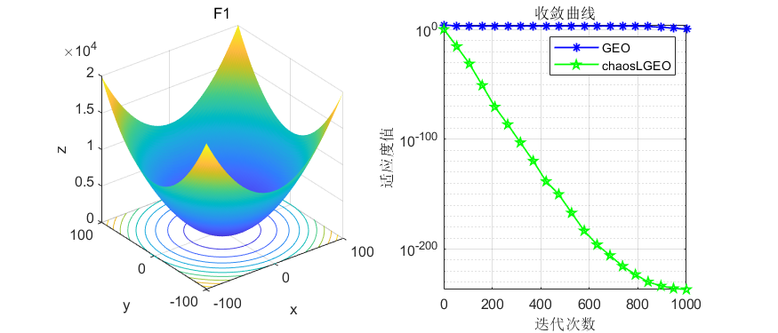
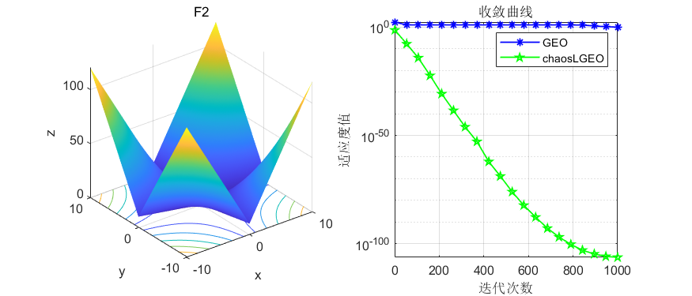
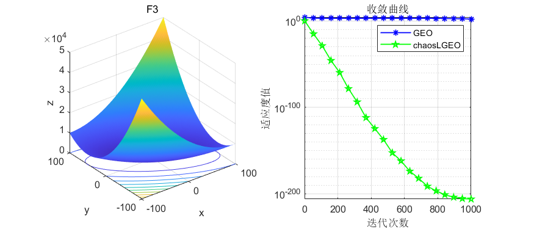
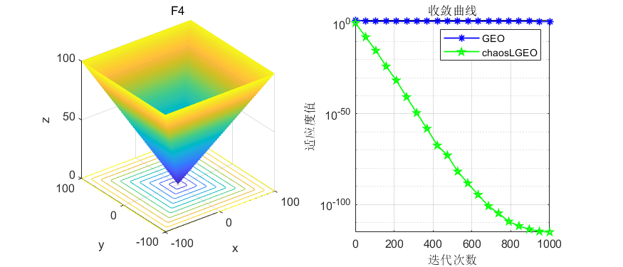
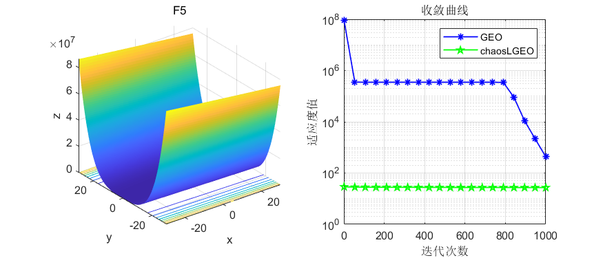
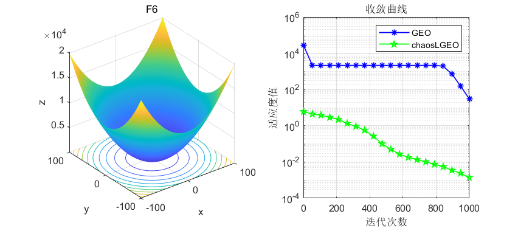
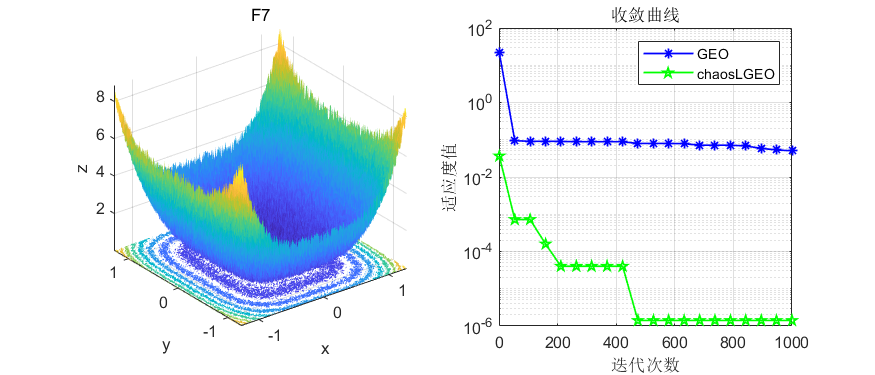
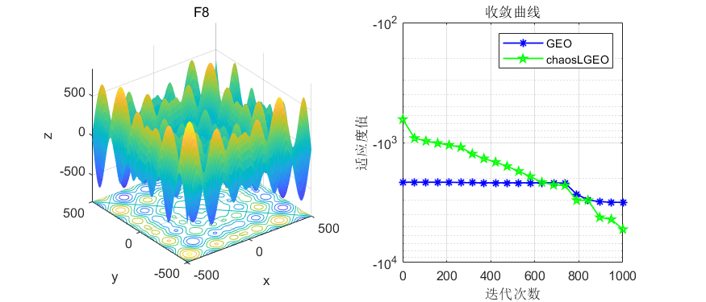
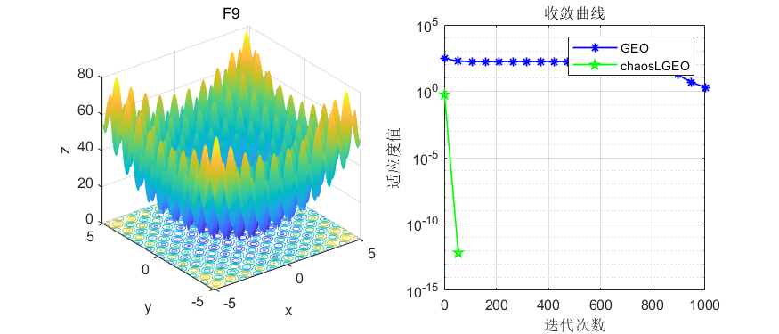
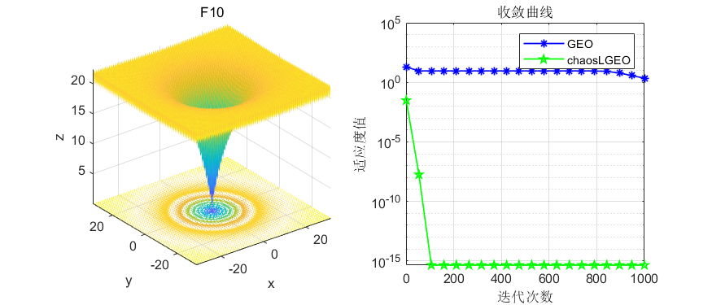
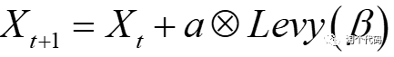
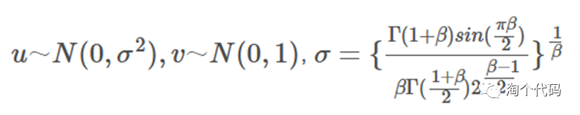
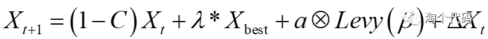
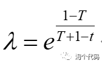

<!-- PAYMENT_BLOCK -->

## Get this dataset

- Payment link (Stripe): [Buy now](https://buy.stripe.com/3cs8yP7sY87d0vu9AB)
- Payment QR code: 

<!-- /PAYMENT_BLOCK -->
